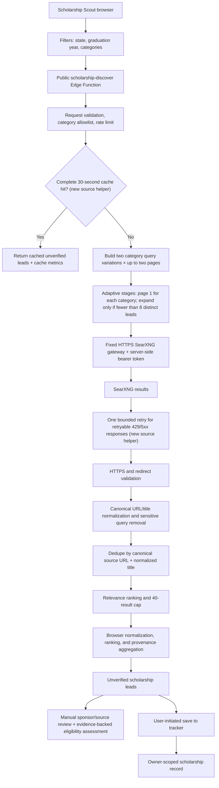

# Agent 03 — Scholarship search and discovery audit

**Audit date:** November 25, 2026  
**Scope:** Scholarship Scout discovery/search pipeline, source normalization, data quality, eligibility evidence gates, and discovery-to-tracker handoff.  
**Canonical product source:** [Scholarship Scout AgentGrid artifact](https://app.agentgrid.io/artifacts/Y9kTsZ0-vazOq3AnWspbAw)  
**Audited source revision:** `1c3bea57c10f092e52531534b1fb40632b1b7a8d`  
**Initial audit report commit:** `13d7cf20a02a62ff17d495fa7e1d638546eec671`  
**Production status:** Supabase `scholarship-discover` ACTIVE, version 9; no deployment was performed during this audit.

## Executive assessment

The search function is a lead-discovery service, not a scholarship verification service. It accepts only broad state, graduation year, and selected category IDs; calls a fixed, token-protected SearXNG gateway; validates and ranks public result URLs; and returns records explicitly marked `unverified_lead`. Award amounts, deadlines, eligibility rules, and sponsor identity must not be inferred from a search snippet.

The most consequential confirmed problems were (1) deployed-versus-client version drift, (2) a fixed four-request-per-category strategy that did not stop when enough good leads had already been found, (3) same-title false-positive deduplication by sponsor domain, and (4) no bounded transient retry or complete-result cache in the checked-in helper. The audit also found a JavaScript syntax error in the evidence-completeness module and an over-escaped age parser that prevented numeric age values from being evaluated correctly.

**Important deployment boundary:** the deployed Supabase function is an inline version-9 snapshot (SHA-256 `5ebc47c217ffdaf9234df5ce12fa4860f671e0641febca218a87aee6a98bc328`). The committed Edge Function wrapper imports `supabase/functions/_shared/scholarship-discovery.mjs`, which has now been optimized, but it is not byte-for-byte the deployed inline snapshot. The new helper changes, tests, and client metadata are committed to the AgentGrid artifact; they have **not** been deployed to Supabase. A shared version number is not proof of source parity.

A further live recovery check on November 25 found the running Quick Tunnel hostname in the original `cloudflared` startup output: `https://plugin-loan-anybody-drilling.trycloudflare.com`. Using the laptop's existing gateway token without exposing it, a direct authenticated GET to that public hostname's `/search` endpoint returned HTTP 200 with 15 results. The local SearXNG service and the public tunnel route are therefore healthy at the time of this check. A fresh POST to the deployed Supabase `scholarship-discover` function nevertheless returned HTTP 502 with `requestedQueries=4`, `successfulQueries=0`, and `failedQueries=4`. This narrows the remaining fault to Supabase's stored `SEARXNG_GATEWAY_URL` and/or `SEARXNG_GATEWAY_TOKEN` configuration (or its ability to reach the URL). The Edge Function source confirms those exact secret names. Supabase's available MCP integration exposes no secret read/write operation, and the laptop has no Supabase CLI installed; no secret values were read, printed, or changed. Do not print or copy gateway tokens into logs. Production live search remains unhealthy until both secrets are reconciled securely and a fresh end-to-end smoke test succeeds. The recovered hostname is a Quick Tunnel URL and may change if the tunnel process is restarted; it is not a durable production endpoint.

## End-to-end discovery pipeline

The client request boundary is deliberately narrow: state, expected graduation year, and selected discovery category IDs only. Student name, school, grades, GPA, class rank, scores, activities, membership details, essays, contact information, and private notes are not sent to the search provider. The browser uses the caller's local profile for relevance ranking and later eligibility comparison.

The search function does not automatically verify the sponsor, extract sponsor eligibility rules, or write a new discovery event into the backlog. A user may explicitly save a lead into the existing tracker/cloud scholarship workflow. Sponsor review and criterion evidence are separate steps. The repository's `scholarship-verify` implementation is a disabled placeholder; no such Edge Function is deployed.

## Findings ranked by severity

| Severity | Finding | Evidence / impact | Status |
|---|---|---|---|
| P1 — Availability | Live discovery still returns HTTP 502 | Local SearXNG, authenticated laptop gateway, and recovered public Quick Tunnel each return HTTP 200; Supabase's Edge Function still reports four failed upstream queries. | Open; reconcile Supabase `SEARXNG_GATEWAY_URL` / `SEARXNG_GATEWAY_TOKEN`, then smoke test |
| P1 — Deployment parity | Deployed v9 is an inline snapshot; checked-in wrapper imports a separate shared helper | Version number alone cannot prove source equivalence. New source optimizations are not live. | Documented; deployment deliberately not performed |
| P1 — Search efficiency | Live v9 makes up to four upstream calls per category regardless of first-page yield | Four categories can produce 16 calls even if each first page already returns enough useful distinct leads. | Adaptive search implemented in committed helper; not deployed |
| P1 — Deduplication integrity | Existing v9 server logic groups by normalized title + sponsor domain | Different award pages with the same title on one sponsor domain may be collapsed. | Canonical URL + normalized title dedupe implemented in helper and client; not deployed |
| P2 — Transient reliability | Live v9 has no bounded provider retry or complete-result cache | A transient 429/5xx fails a page; repeated equivalent requests redo upstream work. | One bounded retry and short-lived cache added to helper; not deployed |
| P2 — Source assurance | Search result relevance/domain signals are not sponsor verification | Snippets and `.edu/.gov` host signals do not establish sponsor identity, active cycle, award amount, or rules. | Existing unverified-lead boundary preserved and tests strengthened |
| P2 — Qualification confidence | Eligibility must stay unknown without evidence tied to each structured rule | Existing eligibility engine already gates criteria on source-linked excerpts; test coverage now exercises this. A pre-existing age parser defect was found and corrected. | Source/test fix committed |
| P2 — Provider resilience | One SearXNG gateway/provider path is configured | No independent provider fallback is present; substituting providers without measured benefit would add risk and was not done. | Open opportunity |
| P2 — Observability/history | No durable provider-level telemetry or automatic discovery-history/backlog event was found | Response summaries report counts, but no persistent per-provider query/failure history is written by discovery. User-initiated tracker save is the handoff. | Response-level request/cache/retry metrics added to helper; persistent telemetry not added |
| P2 — Rate limiting | Public per-IP limiter is in-memory and per Edge Function isolate | It is best-effort and is not a distributed quota; multiple isolates can have separate counters. | Left unchanged; distributed rate limiting is outside this task's permitted boundary |
| P3 — Query diversity | Two fixed category templates are generated from state and graduation year | Live provider queries are not expanded from private profile fields, intentionally. No learned feedback or source-specific query expansion exists. | Preserved; adaptive page/template expansion added without new profile disclosure |
| P3 — Freshness | Discovery timestamps/provenance exist, but search cache/data freshness are not durable | A transient lead result is not a confirmed open application cycle. | 30-second in-memory complete-result cache added to helper; sponsor freshness remains a manual review requirement |

### Version mismatch investigation

Direct Supabase inspection showed `scholarship-discover` ACTIVE at version 9. Before this pass, `src/lib/liveDiscoveryCapabilities.js` and its regression assertion both identified version 8. Those client/test constants now identify version 9. The deployed v9 SHA-256 is recorded above. The live source is an inline function snapshot, while the checked-in function entrypoint imports the shared helper; the new helper logic was not pushed to production. This is the reason version parity is documented as unresolved at the implementation level even though the explicit version-label mismatch is corrected.

## Implemented improvements

### Request efficiency and pagination

- Added an adaptive search runner to the shared Edge Function helper.
- Stage 1 requests page 1 for each selected category.
- Categories with at least 8 distinct, safe, normalized leads stop expanding.
- Only categories below the threshold receive page 2 and the second query variation; low-yield categories retain the original full fallback coverage (up to four jobs each).
- The existing maximum concurrency of four, 12-second request timeout, page result cap, and final 40-result cap remain intact.
- Search summary now distinguishes actual `requestedQueries` from `potentialQueries`, `queriesAvoided`, and retry attempts.

### Deduplication, normalization, and provenance

- Server helper and browser normalizer now deduplicate by canonical source URL plus normalized title, rather than title plus sponsor domain.
- Canonicalization lowercases hosts, removes a leading `www.` alias, strips fragments/trailing slash, sorts retained query parameters, and removes known tracking and sensitive query keys/values such as email, phone, student/user IDs, tokens, and credential-like fields.
- Different source pages on the same sponsor domain no longer collapse solely because their titles match.
- Discovery category, query, page, URL, timestamp, and excerpt provenance remain available for ranking/review; duplicate records merge provenance rather than silently discarding it.
- Search output continues to be whitelisted as an unverified lead. Provider-supplied source-authority or verification claims are not trusted.

### Reliability, cache, and telemetry

- Added a per-isolate, 30-second TTL result cache, capped at 100 least-recently-used entries.
- Only fully successful result sets are cached. Partial or failed results are not cached, allowing later retries to recover missing coverage.
- Cache hits make zero provider calls and return explicit `cacheHit` and `cacheAgeMs` values.
- Added one retry for 429, 500, 502, 503, and 504 responses, bounded to a maximum 1-second wait. Permanent errors are not retried; excessive Retry-After values are rejected.
- Response summaries now expose actual calls, potential calls, avoided calls, retry attempts, cache status/age, successes/failures, page counts, raw results, and unique results.
- These metrics are response-level only. No student data, raw profile fields, API token, or private search history is persisted as telemetry.

### Evidence and eligibility correctness

- Corrected a missing comma in `src/lib/evidence.js` that caused a JavaScript SyntaxError and prevented source-evidence completeness code from loading.
- Corrected an over-escaped digit expression in `src/eligibility.js` that caused ordinary numeric age strings to be treated as unknown.
- Updated capability version metadata and stale test expectation from v8 to deployed v9.
- Strengthened/updated regression tests for sponsor evidence completeness and labels without relaxing verification requirements.
- Sponsor identity, award text/source, deadline evidence, general evidence URL, criterion-specific official source excerpt, and recent sponsor review remain required for verified status.
- Eligibility stays `unknown` when mandatory criterion evidence is missing; search matches are not converted into passes.

## Efficiency measurements

These are deterministic synthetic-provider tests, not production usage measurements.

| Scenario | Baseline fixed plan | Adaptive plan | Avoided calls | Reduction |
|---|---:|---:|---:|---:|
| 4 categories, each first page returns ≥8 distinct usable leads | 16 | 4 | 12 | 75% |
| 2 categories: one high-yield, one below threshold | 8 | 5 | 3 | 37.5% |
| 2 categories, both remain below threshold | 8 | 8 | 0 | 0% (full fallback coverage retained) |
| Repeated identical request within 30-second cache TTL after a complete result | prior run's calls | 0 on cache hit | all repeated calls | 100% for the repeat |

The adaptive tests directly verify the 2→2-call and 8→5-call scenarios, and verify that underfilled categories still receive all four query/page jobs. The cache test verifies that a second equivalent request makes no additional fetch. A real provider benchmark was not possible while the live gateway was returning 502/offline; no live savings claim is made.

## Test evidence

Executed with Node.js **22.23.5** in an isolated network-deny Node sandbox. Targeted suite:

- `tests/scholarshipDiscoverEdge.test.mjs`
- `tests/discoveryPipeline.test.mjs`
- `tests/liveDiscoveryCapabilities.test.mjs`
- `tests/discovery.test.mjs`
- `tests/evidenceCompleteness.test.mjs`
- `tests/evidence.test.mjs`
- `tests/eligibility.test.mjs`
- `tests/sourceReview.test.mjs`

**Actual result:** 145 tests, 145 passed, 0 failed, 0 skipped, 0 cancelled. Node-reported duration: 2.819 seconds. The full application-wide test suite and production build were not run as part of this isolated targeted run.

Coverage includes adaptive query stages and fallback, canonical duplicate handling, same-title/different-page preservation, provenance, URL/PII normalization, per-page caps, bounded concurrency, retryable/permanent errors, Retry-After handling, LRU/TTL expiry, cache hits, partial-result cache exclusion, cache/request telemetry, source-verification gates, evidence completeness, eligibility qualification and unknowns, and source-review history.

## Remaining limitations and next work

1. Reconcile Supabase `SEARXNG_GATEWAY_URL` and `SEARXNG_GATEWAY_TOKEN` with the currently running gateway; prefer a stable named Cloudflare Tunnel for production rather than relying on the ephemeral Quick Tunnel hostname. Then run a fresh public-function smoke test and measure real provider latency/results.
2. Review and deliberately deploy the shared helper to Supabase only after a source diff, request/response contract review, and owner approval. Confirm the deployed SHA and behavior after deploy. None of the new helper improvements is currently live.
3. Add a provider-adapter interface and evaluate alternative providers only with representative search-quality, reliability, privacy, and cost measurements; do not replace SearXNG speculatively.
4. Consider distributed rate limiting and persistent operational telemetry as separate infrastructure changes. Do not put raw student search/profile information in telemetry.
5. Keep sponsor verification human/evidence-led unless a separate verified-source workflow is designed and tested. Search snippets cannot establish award facts.
6. The short-lived cache is per isolate, not globally shared; cold starts and separate isolates do not share entries. A 30-second cache may also return leads that are slightly older than the current search moment.
7. Canonical URL + title cannot distinguish two separate awards that share the same canonical source URL and identical title but expose no other stable discriminator. Such cases still need manual review.
8. Eligibility extraction from live search is not implemented. The existing local rules engine evaluates structured rules already entered into the record; missing/ambiguous sponsor evidence must remain unknown.
9. The response does not persist discovery history or automatically enqueue leads into a backlog. The existing safe handoff is explicit user save to the scholarship tracker.

## Change boundaries

No browser execution, queue persistence, scheduler internals, database schema, RLS policy, Supabase secret, provider configuration, or production deployment was changed. The current Quick Tunnel hostname was recovered and its authenticated public `/search` route was verified; Supabase secret reconciliation remains blocked by the absence of an available secret-management interface. No new provider was introduced. The local Agent-03 worktree remains separate from the dirty primary checkout; the canonical product code changes are in the AgentGrid artifact.
